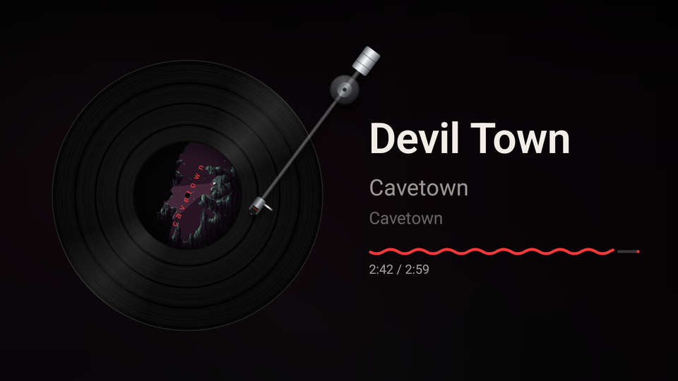
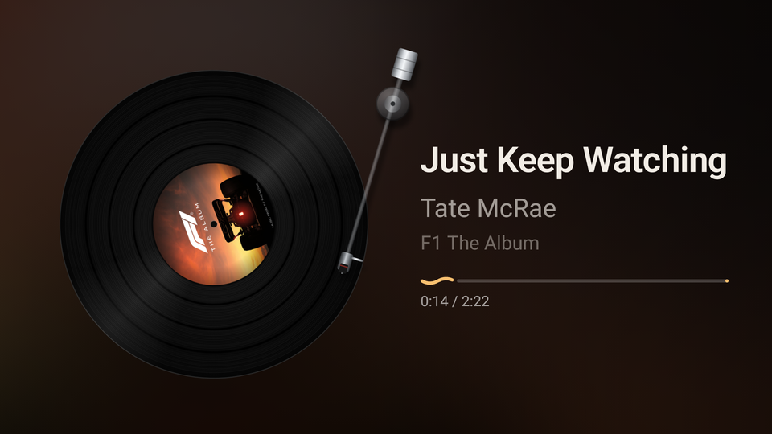
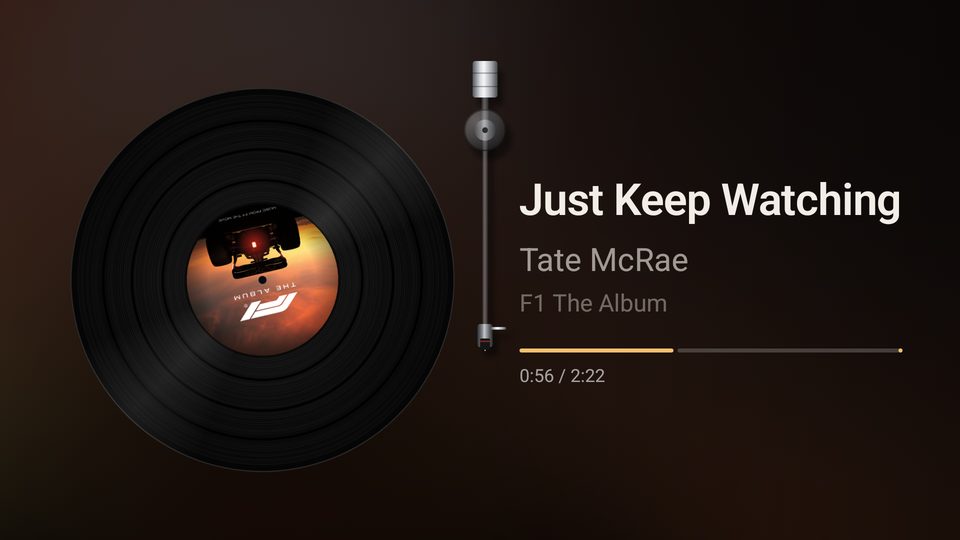
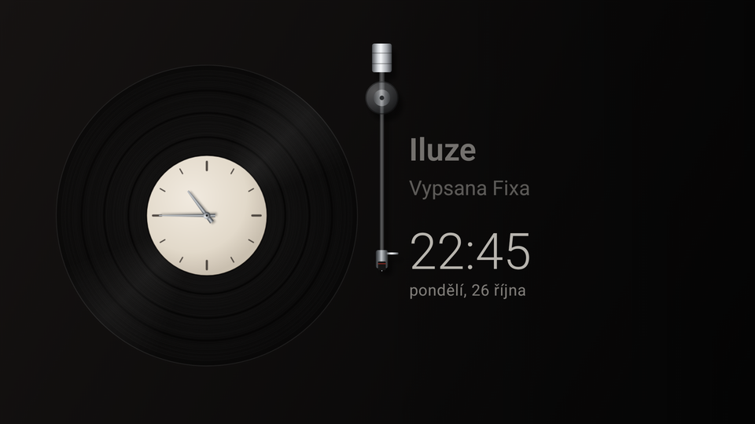
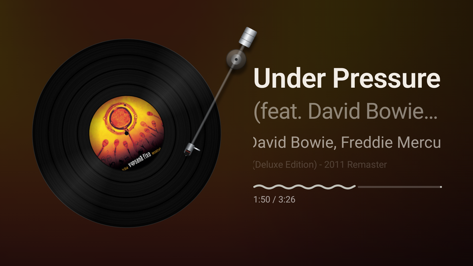
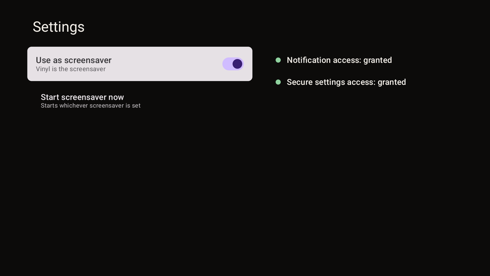

# Vinyl

An Android TV screensaver (DreamService) that shows the currently playing track's album art as a spinning vinyl record. It also works as a regular app from the launcher.

It reads the active media session (built for the Spotify TV app, works with any player that publishes a MediaSession). Sideload only.

- **The record:** the album art is the label, spinning at half of 33⅓ RPM, with grooves, a static sheen and a blurred backdrop of the cover. Pausing eases it to a stop.
- **Tonearm:** the needle moves from the outer groove to the label as the track plays, swings to rest when paused, and lifts back to the start on a new track.
- **Track info:** title, artist and album, with suffixes like "- Remastered 2009" or "(feat. …)" dimmed, long lines scrolling slowly, and a wavy progress bar with elapsed and total time.
- **Idle clock:** with nothing playing, or after 45 s paused, the label turns into a clock face. The text column shows the last track, the time and the date. It redraws once a minute.
- **Burn-in protection:** the whole picture drifts by a few pixels over several minutes.

<table>
  <tr>
    <td width="50%"></td>
    <td width="50%"></td>
  </tr>
  <tr>
    <td align="center">Near the end of a track, the needle is by the label</td>
    <td align="center">Near the start, it's on the outer groove</td>
  </tr>
  <tr>
    <td width="50%"></td>
    <td width="50%"></td>
  </tr>
  <tr>
    <td align="center">Paused: the arm swings to rest</td>
    <td align="center">Idle: a clock, the last track, time and date</td>
  </tr>
  <tr>
    <td width="50%"></td>
    <td width="50%"></td>
  </tr>
  <tr>
    <td align="center">Long titles: dimmed suffix, scrolling lines (debug text preview)</td>
    <td align="center">Settings</td>
  </tr>
</table>

## Build

```bash
./gradlew assembleDebug
```

Needs JDK 17+ and an Android SDK. Put its path in `local.properties` (`sdk.dir=...`) or `ANDROID_HOME`.

## Install and set up

Install:

```bash
adb install -r app/build/outputs/apk/debug/app-debug.apk
```

Grant notification listener access. Android TV has no settings screen for this. Without it the app can't see media sessions and shows these commands instead:

```bash
adb shell cmd notification allow_listener com.smoliicek.vinyl/com.smoliicek.vinyl.NowPlayingListener
```

Grant secure settings access, so the app can switch the system screensaver itself:

```bash
adb shell pm grant com.smoliicek.vinyl android.permission.WRITE_SECURE_SETTINGS
```

Then open Vinyl, press OK on **Settings** and turn on **Use as screensaver**. It saves the current screensaver and restores it when you turn the toggle off. The Settings screen also shows whether both grants are in place.

### Setting the screensaver by hand

You don't need this after the `pm grant` above, because the in-app toggle does the same thing:

```bash
adb shell settings put secure screensaver_components com.smoliicek.vinyl/com.smoliicek.vinyl.VinylDream
```

```bash
adb shell settings put secure screensaver_enabled 1
```

## Testing the screensaver

On most Android builds this starts the screensaver right away:

```bash
adb shell am start -n com.android.systemui/.Somnambulator
```

On the Xiaomi TV this was built on (Android 14, `MiTV_AFMU1`), that activity doesn't exist and `cmd dreams start-dreaming` needs root. The in-app **Start screensaver now** button shows a toast there and returns to the vinyl view. To trigger the screensaver anyway, shorten the idle timeout for a moment:

```bash
adb shell settings get system screen_off_timeout
```

```bash
adb shell settings put system screen_off_timeout 15000
```

Wait about 15 seconds, then put the original value back (it was `600000` on that TV):

```bash
adb shell settings put system screen_off_timeout 600000
```

## Logs

```bash
adb logcat -s VinylDebug
```

Every metadata change logs the keys the player sends, with bitmap sizes and art URIs. It also logs the session list with each session's state. For Spotify TV that is `ALBUM`, `ALBUM_ART` (640×640 bitmap), `ALBUM_ART_URI` (https), `ARTIST`, `DISPLAY_ICON` (160×160), `DURATION`, `TITLE` and `ADVERTISEMENT`.

## How it works

- `NowPlayingListener`: an empty `NotificationListenerService`. Being an enabled listener is what allows `MediaSessionManager.getActiveSessions()`.
- `NowPlayingRepository`: listens for session changes and controller callbacks, with no polling. It prefers a `PLAYING` session, otherwise the session with metadata that changed most recently. Sessions in `ERROR` state, like the dead Bluetooth ones, are ignored. For art it uses the metadata bitmaps first, then loads the art URIs with Coil. It also reports duration and the playback position, which `estimatePosition()` advances between updates. If the listener permission is missing, it waits for it to be granted.
- `VinylDream`: a `DreamService` that acts as its own Lifecycle, SavedStateRegistry and ViewModelStore owner, so Compose can run inside it.
- `MainActivity`: the same vinyl view, plus Settings (`SystemSetup` handles the `Settings.Secure` writes). It doesn't keep the screen on, so the system screensaver takes over when the TV is idle.
- `VinylUi`, `VinylBitmaps`: the record, its sheen and the blurred backdrop are drawn once per track into bitmaps, off the main thread. Each frame only rotates or blits them, which keeps the TV's GPU at about 11 ms per frame.
- `Tonearm`, `TonearmGeometry`: the arm is one cached bitmap rotated around its pivot. The angle for each groove radius comes from the law of cosines, with unit tests.
- `SongProgress`: Material 3 Expressive's wavy progress indicator. The wave flattens when paused.
- `IdleClock`: idle detection, the clock face and hands, and the idle text column.
- `TrackSuffix`: splits "- Remastered 2009", "(feat. …)" and similar off titles, with unit tests.

Debug builds accept `debug_title`, `debug_artist` and `debug_album` intent extras, to preview long text over the real art:

```bash
adb shell "am start -n com.smoliicek.vinyl/.MainActivity --es debug_title 'Under Pressure (feat. David Bowie) - Remastered 2011'"
```

## Tests

```bash
./gradlew testDebugUnitTest
```
